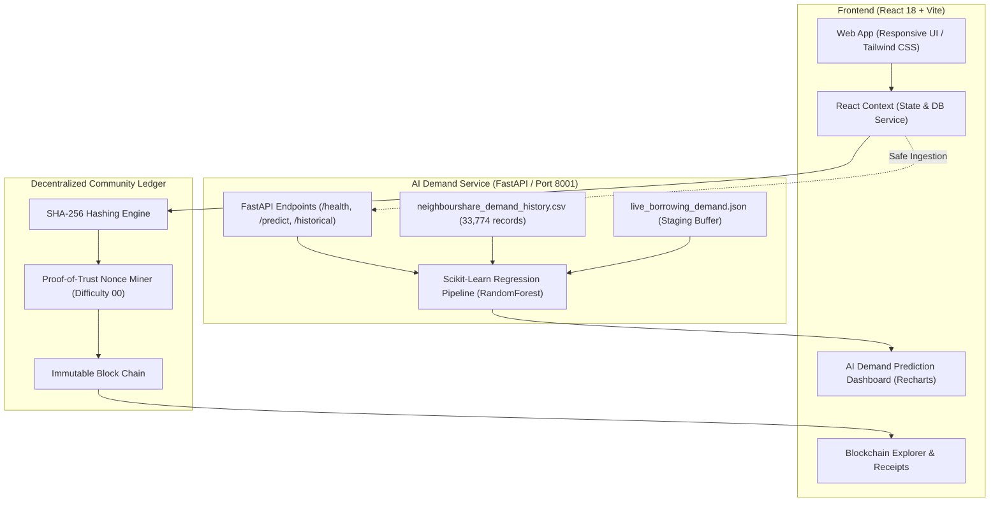
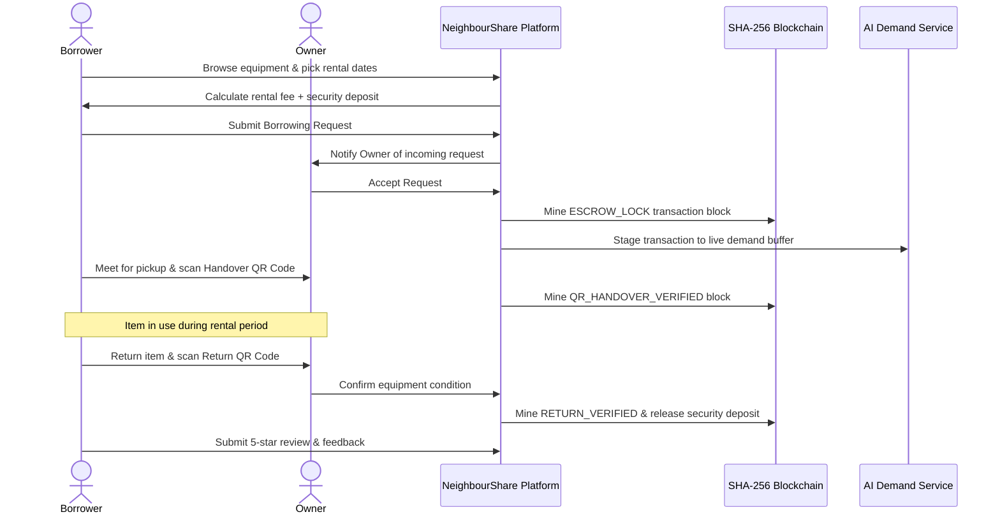

# NeighbourShare Community Hub — Smart Neighbourhood Equipment Sharing Platform

> **"Share More, Spend Less, Live Better."**

NeighbourShare is a comprehensive full-stack community-based equipment-sharing platform that connects neighbours who own household tools and electrical equipment with neighbours who need to borrow them temporarily. By integrating modern web interfaces, a cryptographic SHA-256 blockchain transaction ledger, and a local machine learning rental demand prediction engine, NeighbourShare fosters resource optimization, neighbourhood collaboration, and environmental sustainability.

---

## 1. Problem Statement

Modern households frequently invest significant money into purchasing power tools, repair equipment, gardening machinery, and cleaning appliances that are used for only a few minutes or hours each year. For instance, a household drilling machine is typically utilized for an average of less than 15 minutes across its entire lifespan. 

This leads to:
- **Excessive consumer expenditure** on redundant tools and machinery.
- **Urban storage inefficiency** and cluttered garages and apartments.
- **Environmental waste and carbon footprints** stemming from repetitive manufacturing and consumer disposals.
- **Weakened community cohesion**, where neighbours rarely interact or share local resources.

---

## 2. Project Objectives

- **Reduce Redundant Purchases**: Enable neighbours to rent high-quality equipment on-demand at low hourly or daily rates.
- **Foster Community Trust & Engagement**: Build verifiable reputation scores, user profiles, and transparent lending histories.
- **Ensure Tamper-Proof Financial & Handover Accounting**: Utilize a decentralized cryptographic SHA-256 blockchain ledger to record deposits, loans, and return receipts.
- **Anticipate Rental Demand via Machine Learning**: Deploy an autoregressive Random Forest regression model to forecast category-level demand without third-party cloud AI APIs.
- **Promote Environmental Sustainability**: Quantify community impact metrics including CO₂ emissions avoided and cumulative money saved.

---

## 3. Main Features

### 3.1 Equipment Catalog & Search
- **6 Comprehensive Categories**:
  - *Electrical Tools*: Impact drills, grinders, screwdrivers, cutters.
  - *Home Repair Tools*: Toolkits, ladders, spanners, hammers.
  - *Gardening Equipment*: Lawn aerators, grass cutters, hedge trimmers, water pumps.
  - *Cleaning Equipment*: High-pressure washers, industrial vacuum cleaners, dehumidifiers.
  - *Household Appliances*: Heavy-duty extension boards, heaters.
  - *Other Equipment*: Specialty tools, mini dumpers, pipe pressing machines.
- **Location-Preserving Neighbourhood Search**: Shows approximate neighbourhood and distance (e.g., *Indiranagar 4th Block • ~0.4 km away*) without exposing exact residential addresses until requests are confirmed.
- **Multi-Filter System**: Instant filtering by category, availability ("Available Now" vs. "In Use / Reserved"), price slider, and search keywords.

### 3.2 Borrowing & Booking Workflow
- **Dynamic Fee Calculator**: Automatic rate calculation based on hourly or daily durations plus refundable safety deposit.
- **Double-Booking Prevention**: Date and time conflict validation preventing overlapping bookings.
- **QR Code Handover & Return Verification**: Dual-phase cryptographic OTP and QR code scanning for physical item collection and return verification.

### 3.3 Role-Based Dashboards
- **Borrower Dashboard**: Track active loans, pending requests, return deadlines, countdown timers, total money spent, and review submissions.
- **Owner Dashboard**: Manage listings, toggle equipment availability, approve/decline incoming requests, inspect rental earnings (₹), and view on-chain settlement receipts.
- **Admin Panel**: Monitor platform-wide metrics, review dispute and damage reports, moderate equipment listings, and verify community members.
- **Environmental Impact Counter**: Real-time counter of total tools shared, estimated kilograms of CO₂ emissions prevented, and community financial savings.

---

## 4. Technology Stack

| Layer | Technologies |
| :--- | :--- |
| **Frontend Framework** | React 18, Vite 5 |
| **Styling & UI** | Tailwind CSS 3, Lucide React icons, Canvas Confetti |
| **Data Visualizations** | Recharts (Area charts, Bar charts, Donut charts, Dual-line comparison) |
| **Verification & QR** | QRCode.React, SHA-256 cryptographic hashing |
| **State & Local Storage** | React Context API, Web LocalStorage & IndexedDB fallback |
| **Backend AI Microservice** | Python 3.11, FastAPI, Uvicorn |
| **Machine Learning Pipeline** | Scikit-Learn 1.6.1, Joblib, Pandas, NumPy |
| **Blockchain** | Custom SHA-256 Proof-of-Trust blockchain ledger |

---

## 5. System Architecture



---

## 6. AI Equipment Rental Demand Prediction

NeighbourShare integrates an offline, proprietary Machine Learning microservice trained with **Google Colab** on 33,700+ historical daily equipment rental records spanning multi-year operations.

### 6.1 Model Architecture & Hyperparameters
- **Model Type**: Scikit-Learn `RandomForestRegressor`
- **Trained Pipeline**:
  - `ColumnTransformer` with `OneHotEncoder(handle_unknown='ignore')` on the categorical `Category` attribute.
  - `passthrough` transformation for 10 numerical and temporal features.
  - Regressor settings: `max_depth=12`, `min_samples_leaf=3`, `n_jobs=-1`, `random_state=42`.
- **Validation Metrics**:
  - Mean Absolute Error ($MAE$): `1.165` units
  - Root Mean Squared Error ($RMSE$): `1.937` units
  - Coefficient of Determination ($R^2$): `0.511`

### 6.2 The 11 Dynamic Feature Signals
The prediction engine dynamically computes 11 features matching the exact training distribution without hardcoded values:
1. `Category` (*Aerator*, *Dehumidifier*, *Forklift*, *Heater*, *Mini dumper*, *Pipe pressing machine*)
2. `Day_of_Week` ($0=\text{Monday}, \dots, 6=\text{Sunday}$)
3. `Month` ($1 \dots 12$)
4. `Day_of_Year` ($1 \dots 366$)
5. `Is_Weekend` ($1 \text{ if Saturday/Sunday else } 0$)
6. `Lag_1` (Demand $t-1$)
7. `Lag_7` (Demand $t-7$)
8. `Lag_14` (Demand $t-14$)
9. `Lag_28` (Demand $t-28$)
10. `Rolling_Mean_7` (7-day historical moving average)
11. `Rolling_Mean_28` (28-day historical moving average)

### 6.3 Safe Data Integration & Category Isolation
To prevent corrupting original construction-equipment training baselines with household tool records:
- Live approved/completed borrowings are staged in `live_borrowing_demand.json`.
- Cancelled or rejected requests are strictly ignored.
- Household categories are systematically mapped to corresponding baseline equipment profiles for incremental transfer learning.

---

## 7. Blockchain Implementation

NeighbourShare features an in-browser, mathematically verified **SHA-256 Blockchain Ledger** that guarantees transaction immutability and transparent community accountability.

- **Genesis Block**: Pre-mined genesis block anchoring the community network (`0000genesis...`).
- **Proof-of-Trust Mining**: Blocks are mined using proof-of-work with dynamic difficulty (`00` prefix).
- **On-Chain Transaction Types**:
  1. `EQUIPMENT_REGISTRATION`: Initial listing tokenization.
  2. `ESCROW_LOCK`: Security deposit and rental fee holding upon booking.
  3. `QR_HANDOVER_VERIFIED`: Verification of physical exchange with hashed OTP.
  4. `RETURN_VERIFIED`: Condition verification and automated deposit release.
- **Public Explorer**: Live explorer modal allowing users to inspect parent hash links, Merkle roots, timestamps, gas fees (`0.00 NSG`), and downloadable cryptographic certificates.

---

## 8. Borrowing Lifecycle



---

## 9. Installation Instructions

### Prerequisites
- **Node.js**: v18.0.0 or higher
- **Python**: v3.10 or v3.11
- **Package Managers**: `npm` (Node) and `pip` or `uv` (Python)

### Clone the Repository
```bash
git clone https://github.com/<your-username>/neighbourshare-community-hub.git
cd neighbourshare-community-hub
```

---

## 10. How to Run the Frontend

1. Install Node dependencies:
   ```bash
   npm install
   ```

2. Start the Vite development server:
   ```bash
   npm run dev
   ```

3. Open your browser and navigate to:
   ```
   http://localhost:5173
   ```

4. Build for production (optional):
   ```bash
   npm run build
   ```

---

## 11. How to Run the FastAPI Backend

1. Navigate to the AI microservice directory:
   ```bash
   cd ai_service
   ```

2. Create and activate a Python virtual environment:
   ```bash
   # On Windows
   python -m venv .venv
   .\.venv\Scripts\activate

   # On macOS / Linux
   python3 -m venv .venv
   source .venv/bin/activate
   ```

3. Install requirements:
   ```bash
   pip install -r requirements.txt
   ```

4. Launch the FastAPI server via Uvicorn:
   ```bash
   uvicorn app:app --host 127.0.0.1 --port 8001 --reload
   ```

5. Verify backend health in browser or terminal:
   ```
   http://127.0.0.1:8001/health
   ```

---

## 12. Project Folder Structure

```
neighbourshare-community-hub/
├── .gitignore                          # Excludes node_modules, .venv, caches, logs
├── index.html                          # Single-page application entry point
├── package.json                        # Frontend dependencies and npm scripts
├── package-lock.json                   # Deterministic package dependency tree
├── postcss.config.js                   # PostCSS configuration for Tailwind
├── tailwind.config.js                  # Tailwind design system tokens & colors
├── vite.config.js                      # Vite bundler build settings
├── README.md                           # Comprehensive documentation & architecture
│
├── ai_service/                         # Python FastAPI Machine Learning Microservice
│   ├── app.py                          # FastAPI application & autoregressive prediction endpoints
│   ├── model_metadata.json             # Scikit-Learn training evaluation metadata & features
│   ├── neighbourshare_demand_history.csv # 33,774 historical rental records (2004–2020)
│   ├── neighbourshare_demand_model.joblib # Trained Random Forest regression pipeline (~12 MB)
│   ├── live_borrowing_demand.json      # Staged live transaction buffer for safe ingestion
│   └── requirements.txt                # Python dependencies (scikit-learn, fastapi, pandas, uvicorn)
│
├── src/                                # React Frontend Source Code
│   ├── App.jsx                         # Main router & active view orchestrator
│   ├── main.jsx                        # React root bootstrap
│   ├── index.css                       # Global styles & Tailwind directives
│   │
│   ├── context/                        # Global Application State
│   │   └── AppContext.jsx              # Central context provider (auth, modals, catalog, notifications)
│   │
│   ├── services/                       # Core Business Logic & Services
│   │   ├── aiService.js                # Frontend API client communicating with FastAPI (port 8001)
│   │   ├── blockchain.js               # Cryptographic SHA-256 block structure & proof-of-work miner
│   │   ├── db.js                       # Data access layer for equipment, requests, and reviews
│   │   ├── firebase.js                 # Optional Firebase configuration helper
│   │   └── seedData.js                 # Initial seed dataset with community tools & users
│   │
│   └── components/                     # React UI Components
│       ├── ai/
│       │   └── DemandPredictionDashboard.jsx # Interactive ML demand charts & forecast dashboard
│       ├── auth/
│       │   ├── AuthModal.jsx           # Sign In, Registration, and Password Reset modal
│       │   └── ProfileModal.jsx        # User profile editor and reputation score
│       ├── blockchain/
│       │   ├── BlockchainExplorer.jsx  # Interactive visual blockchain ledger & block auditor
│       │   └── TransactionReceiptModal.jsx # Verifiable digital receipt & cryptographic certificate
│       ├── booking/
│       │   └── QRCodeModal.jsx         # Dynamic handover and return QR code verification
│       ├── common/
│       │   ├── Navbar.jsx              # Responsive header navigation with role toggles & badges
│       │   ├── Footer.jsx              # Platform links, community disclaimer & mission statement
│       │   ├── RatingStars.jsx         # 5-star rating renderer
│       │   ├── ToastContainer.jsx      # Animated floating toast notifications
│       │   └── FirebaseConfigModal.jsx # Setup modal for optional cloud persistence
│       ├── community/
│       │   ├── CommunityHub.jsx        # Local activity feed, member directory & wishlist board
│       │   ├── MessengerModal.jsx      # Real-time chat between borrower and lender
│       │   └── ReportIssueModal.jsx    # Dispute and equipment damage escalation modal
│       ├── dashboard/
│       │   ├── AdminDashboard.jsx      # Administrator overview, catalog moderation & dispute tools
│       │   ├── BorrowerDashboard.jsx   # Active loans, return countdowns & rental history
│       │   ├── OwnerDashboard.jsx      # Inventory manager, request approvals & earnings (₹)
│       │   └── ImpactDashboard.jsx     # CO₂ avoided, trees saved & financial impact metrics
│       └── equipment/
│           ├── EquipmentCatalog.jsx    # Search, category filters & availability directory
│           ├── EquipmentCard.jsx       # Equipment card with condition pill & price rates
│           ├── EquipmentDetailModal.jsx# Equipment booking modal with duration & price calculator
│           └── AddEditEquipmentModal.jsx# Form to publish new equipment with photo presets
```

---

## 13. Future Enhancements

- **Direct Payment Gateway Integration**: Native integration with UPI (Razorpay/Stripe) for automated security deposit escrow holds and direct bank payouts.
- **Automated Retraining Worker**: Scheduled background pipeline to periodically retrain the Random Forest model on accumulated genuine borrowing transactions.
- **Mobile PWA & Push Notifications**: Service Worker integration for push alerts when borrowing requests are received or return deadlines approach.
- **Geofencing & Dynamic Radius Search**: Interactive Mapbox/Leaflet map with customizable radius boundaries.
- **Smart Contract Deployment**: Bridge local SHA-256 blockchain ledger to Ethereum Layer 2 (Polygon or Arbitrum) for decentralized smart contracts.

---

## 14. Acknowledgements

This application was developed with assistance from **Antigravity**, Google DeepMind's agentic AI assistant.
